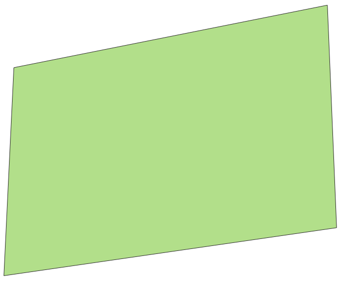
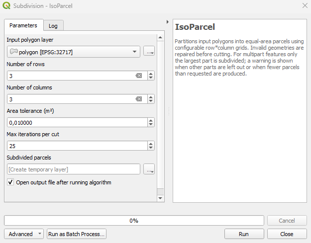
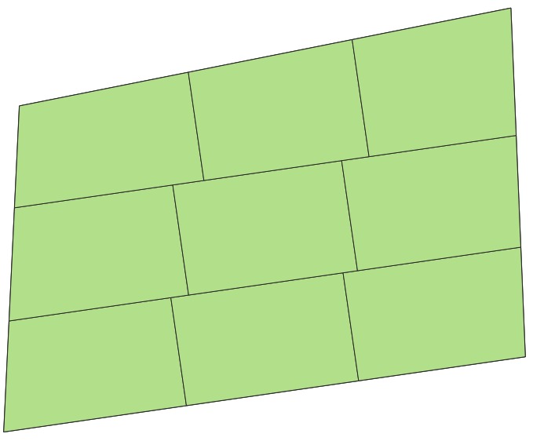

# IsoParcel tutorial

IsoParcel splits each polygon of a layer into a grid of rows × columns parcels of equal area.

*Versión en español: [TUTORIAL_es.md](TUTORIAL_es.md)*

## 1. Requirements

- QGIS 3.34 or later.
- Polygon layer in a **projected CRS with units in metres** (e.g. UTM). If it is in EPSG:4326, reproject it first (*Vector ‣ Data Management Tools ‣ Reproject Layer*).
- Multipart features: only the largest part is subdivided. To process every part, run *Multipart to singleparts* first.

## 2. Installation

*Plugins ‣ Manage and Install Plugins…* → search **IsoParcel** → *Install*.
From a ZIP file (GitHub or Zenodo release): *Install from ZIP*.

## 3. Step by step

**Step 1. Load the layer to subdivide.**



**Step 2. Open IsoParcel and set the grid.** *Processing ‣ Toolbox ‣ Subdivision ‣ IsoParcel*.



| Parameter | Default | Use |
|---|---|---|
| Input polygon layer | | Layer to subdivide (all features are processed). |
| Number of rows | 2 | 1 to 50. |
| Number of columns | 2 | 1 to 50. |
| Area tolerance (m²) | 0.01 | Pieces of this area or smaller are discarded. |
| Max iterations per cut | 25 | Limit of the binary search for each cut. |
| Subdivided parcels | temporary layer | Output layer. |

**Step 3. Click *Run*.**



## 4. Output

The output keeps the input attributes and adds:

- `parent_id`: id of the input feature.
- `parcel_idx`: parcel number within the feature, 1 to rows × columns (from the bottom row, left to right, after alignment).

To check the areas, add a field with `$area` in the Field Calculator and compare values within each `parent_id`.

## 5. Log messages

Check the *Log* tab. One failing feature does not stop the run.

- *Feature N failed*: geometry could not be processed; it is skipped.
- *Feature N is multipart…*: only its largest part was subdivided.
- *Feature N produced k parcels instead of rows × columns*: usually a concavity split a row into separate pieces. Review that feature or try another grid.

## 6. Which polygons work well

Success depends on how convex the polygon is. Compute the convexity index (CI) in the Field Calculator:

```
$area / area(convex_hull($geometry))
```

In the validation with 370 real parcels (v1.0.3, with the rotation step), 93.7 % of the runs were successful for CI ≥ 0.85, 47.2 % for 0.60 ≤ CI < 0.85, and 16.9 % for CI < 0.60. Review parcels with low CI manually.

## 7. How to cite

Delgado-Alcívar, R. A. (2026). IsoParcel: Equal-area polygon partitioning plugin for QGIS [Computer software]. Zenodo. https://doi.org/10.5281/zenodo.20225169

This DOI always resolves to the latest version.
