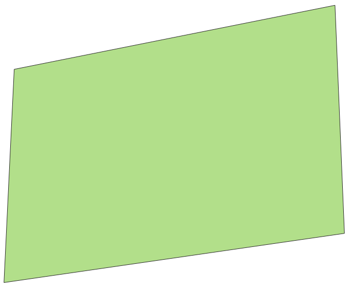
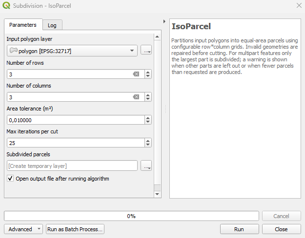
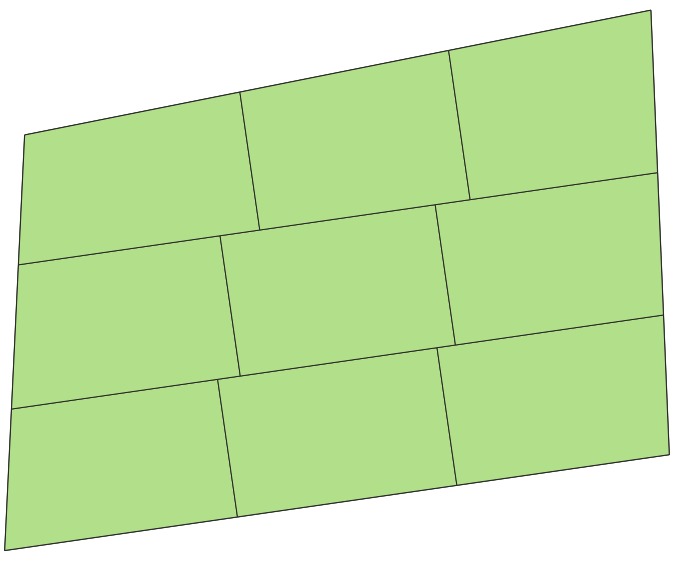

# Tutorial de IsoParcel

IsoParcel divide cada polígono de una capa en una cuadrícula de filas × columnas parcelas de igual área.

*English version: [TUTORIAL.md](TUTORIAL.md)*

## 1. Requisitos

- QGIS 3.34 o posterior.
- Capa de polígonos en un **SRC proyectado con unidades en metros** (p. ej. UTM). Si está en EPSG:4326, reproyéctala antes (*Vectorial ‣ Herramientas de gestión de datos ‣ Reproyectar capa*).
- Entidades multiparte: solo se subdivide la parte de mayor área. Para procesar todas las partes, ejecuta antes *De multiparte a monoparte*.

## 2. Instalación

*Complementos ‣ Administrar e instalar complementos…* → buscar **IsoParcel** → *Instalar*.
Desde un ZIP (versión de GitHub o Zenodo): *Instalar a partir de ZIP*.

## 3. Paso a paso

**Paso 1. Carga la capa a subdividir.**



**Paso 2. Abre IsoParcel y define la cuadrícula.** *Procesos ‣ Caja de herramientas ‣ Subdivision ‣ IsoParcel*.



| Parámetro | Por defecto | Uso |
|---|---|---|
| Input polygon layer | | Capa a subdividir (se procesan todas sus entidades). |
| Number of rows | 2 | 1 a 50. |
| Number of columns | 2 | 1 a 50. |
| Area tolerance (m²) | 0.01 | Se descartan las piezas de esta área o menor. |
| Max iterations per cut | 25 | Límite de la búsqueda binaria en cada corte. |
| Subdivided parcels | capa temporal | Capa de salida. |

**Paso 3. Pulsa *Ejecutar*.**



## 4. Salida

La salida conserva los atributos de entrada y agrega:

- `parent_id`: id de la entidad de entrada.
- `parcel_idx`: número de parcela dentro de la entidad, de 1 a filas × columnas (desde la fila inferior, de izquierda a derecha, tras la alineación).

Para comprobar las áreas, agrega un campo con `$area` en la calculadora de campos y compara los valores dentro de cada `parent_id`.

## 5. Mensajes del registro

Revisa la pestaña *Registro*. Una entidad con error no detiene la ejecución.

- *Feature N failed*: la geometría no pudo procesarse; se omite.
- *Feature N is multipart…*: solo se subdividió su parte mayor.
- *Feature N produced k parcels instead of rows × columns*: normalmente una concavidad partió una fila en piezas separadas. Revisa esa entidad o prueba otra cuadrícula.

## 6. Qué polígonos funcionan bien

El éxito depende de qué tan convexo es el polígono. Calcula el índice de convexidad (IC) en la calculadora de campos:

```
$area / area(convex_hull($geometry))
```

En la validación con 370 predios reales (v1.0.3, con el paso de rotación), el 93,7 % de las ejecuciones fue exitoso con IC ≥ 0,85; el 47,2 % con 0,60 ≤ IC < 0,85; y el 16,9 % con IC < 0,60. Revisa manualmente los predios con IC bajo.

## 7. Cómo citar

Delgado-Alcívar, R. A. (2026). IsoParcel: Equal-area polygon partitioning plugin for QGIS [Computer software]. Zenodo. https://doi.org/10.5281/zenodo.20225169

Este DOI siempre apunta a la última versión.
